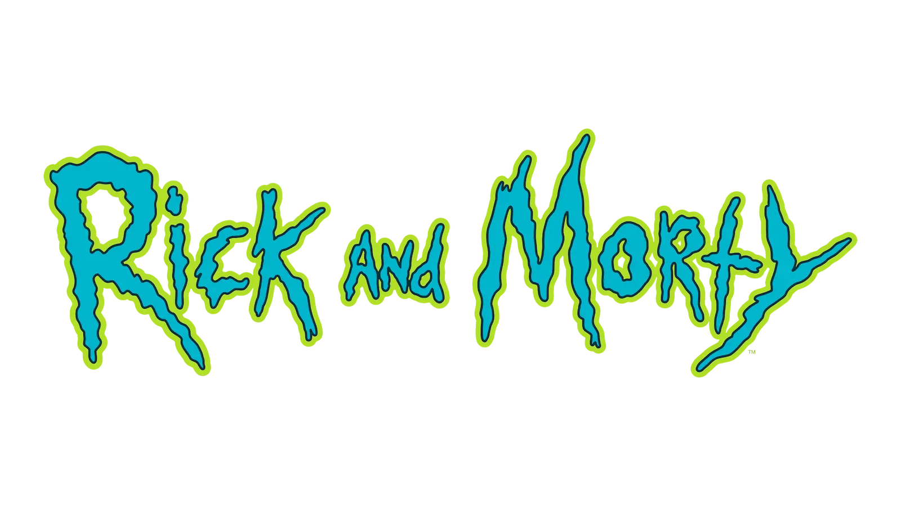

# Rick and Morty Explorer

**Live demo:** [rick-and-morty-explorer-rho.vercel.app](https://rick-and-morty-explorer-rho.vercel.app/)



Rick and Morty Explorer is a Nuxt 4 app for browsing and searching characters from the [Rick and Morty API](https://rickandmortyapi.com/). You can search characters, page through results, and open a detail page for each one.

For the reasoning behind key decisions, see [Implementation Details](#implementation-details).

## Getting Started

### Prerequisites

- Node.js 20.19+ or 22.12+
- npm

### Installation

```bash
npm install
```

The `postinstall` script runs `nuxt prepare` automatically.

### Development

```bash
npm run dev
```

The app runs at `http://localhost:3000`.

### Production

```bash
npm run build
npm run preview
```

## Implementation Details

- **Logo:** The original logo was too heavy, so I resized it and converted it to WebP for better performance.
- **State management:** The project is small, so I didn't use a state management library like Pinia. Each component manages its own local state.
- **Data loading:** [`useCharacters.ts`](app/composables/useCharacters.ts) uses computed properties on top of `useAsyncData` to keep the data logic separate from the view.
- pass {signal} in [getCharacters](app/composables/useCharacters.ts) the new call aborts the previous one, and $fetch now honors that.
- **Search:** The search input is debounced with [VueUse](https://vueuse.org/).
- **Search feedback:** Search results have dedicated error and empty state components.
- **Errors:** 404, 429 and 500 errors are handled by a separate error page.
- **Loading:** Skeleton placeholders ([Loading.vue](app/components/generals/Loading.vue)) are shown while data loads.
- **Shared header:** [AppHeader](app/components/generals/AppHeader.vue) uses two `<slot>`s because the home and detail pages share the same header (gradient background and logo placement). The home page passes the search component into one slot, and the detail page passes the character details (image, title, status) into the other.
- **API:** The [data types](app/types/character.ts) and [API client](app/services/character.service.ts) are based on the [official API documentation](https://rickandmortyapi.com/documentation).
- **Design:** The UI is built to match the provided Figma design as closely as possible.
